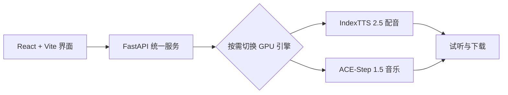

<div align="center">
  
  <h1>Yumi Sound Studio</h1>
  <p><strong>小Y声音工坊 · Make Every Sound Bloom.</strong></p>
  <p>一个可爱、简洁、完全在本地运行的 AI 配音与音乐工作室。</p>
  <p>A cute, local-first AI studio for expressive speech, voice cloning and music creation.</p>
</div>

---


## ✨ 它能做什么 / Features

| 功能 | 说明 |
| --- | --- |
| 🎙️ 文字配音 | 基于 **IndexTTS 2.5** 克隆参考音色，支持中、英、日语言和多种采样策略 |
| 😊 情感控制 | 支持参考情绪音频、预设情绪和八维情绪向量 |
| 🎵 音乐生成 | 基于 **ACE-Step 1.5** 生成纯音乐或带歌词音乐 |
| 🎚️ 参考音乐改编 | 支持整体改编、Flow-Edit 轻量编辑、局部重绘和旋律保留 |
| 🤖 小Y Agent | 用自然语言描述需求，自动整理音乐参数并调用本地模型 |
| 🐾 动态宠物 | 可拖动、记忆位置，并根据待机、专注、思考和完成状态切换姿态 |

> Voice cloning, expressive speech, text-to-music, reference-based music editing and an intelligent local audio agent—all in one friendly interface.

## 🎵 音乐改编

上传参考音乐后，可以先使用“戏曲急迫”“极简保留”“电影紧张”“国风悲情”等预设，再展开专业设置调整：

- 旋律保留程度、BPM、调式和拍号
- 快速、均衡、高质量推理
- 固定或随机种子
- 一次生成 1–4 个候选版本
- WAV、FLAC、MP3 输出
- 音量标准化、淡入淡出和负面提示词


## 🤖 小Y声音 Agent

点击或拖动右下角的小Y，直接说出想法，例如：

> 保持原节奏，原声小一点，多加快板和二胡，生成两个高质量版本。

小Y会理解节奏、情绪、乐器、保留程度、编辑模式和生成质量，并自动填写参数。音乐和参考素材不会上传到云端。


## 🧩 工作方式



为适配消费级显卡，后台同一时间只保留一个生成模型。切换“文字配音”和“音乐改编”时，Yumi 会自动管理模型进程并释放显存。

## 🚀 本地部署 / Local Setup

### 环境要求

- Windows 10/11
- NVIDIA GPU，推荐 12GB 以上显存
- Python 3.11
- [uv](https://docs.astral.sh/uv/)
- Node.js 20+
- 已完成模型部署的 [IndexTTS 2.5](https://github.com/index-tts/index-tts) 与 [ACE-Step 1.5](https://github.com/ace-step/ACE-Step-1.5)

将三个项目放在同一父目录，并保持以下名称：

```text
index_tts/
├─ index-tts-2.5/
├─ ACE-Step-1.5/
└─ Yumi-Sound-Studio/
```

安装 Yumi 依赖：

```powershell
cd Yumi-Sound-Studio
uv sync
npm --prefix frontend install
npm --prefix frontend run build
```

双击 `start-studio.bat`，或执行：

```powershell
uv run python run.py
```

浏览器访问 <http://127.0.0.1:7862/>。

> Yumi 不包含 IndexTTS、ACE-Step 的模型权重。请分别按照上游项目说明下载模型并确认其启动脚本可用。

## 📁 项目结构

```text
Yumi-Sound-Studio/
├─ backend/                 # FastAPI、任务管理与模型参数映射
├─ frontend/                # React、可爱风 UI 与小Y Agent
├─ docs/images/             # README 截图
├─ runtime/                 # 本地上传、输出和日志（不会提交）
├─ run.py                   # 统一服务入口
└─ start-studio.bat         # Windows 一键启动
```

生成结果位于 `runtime/outputs`，运行日志位于 `runtime/logs`。

## ✅ 开发验证

```powershell
npm --prefix frontend run build
uv run pytest -q
```

## 🙏 致谢 / Credits

- [IndexTTS](https://github.com/index-tts/index-tts)
- [ACE-Step](https://github.com/ace-step/ACE-Step-1.5)

请同时遵守本项目依赖和模型各自的许可证及使用条款。
