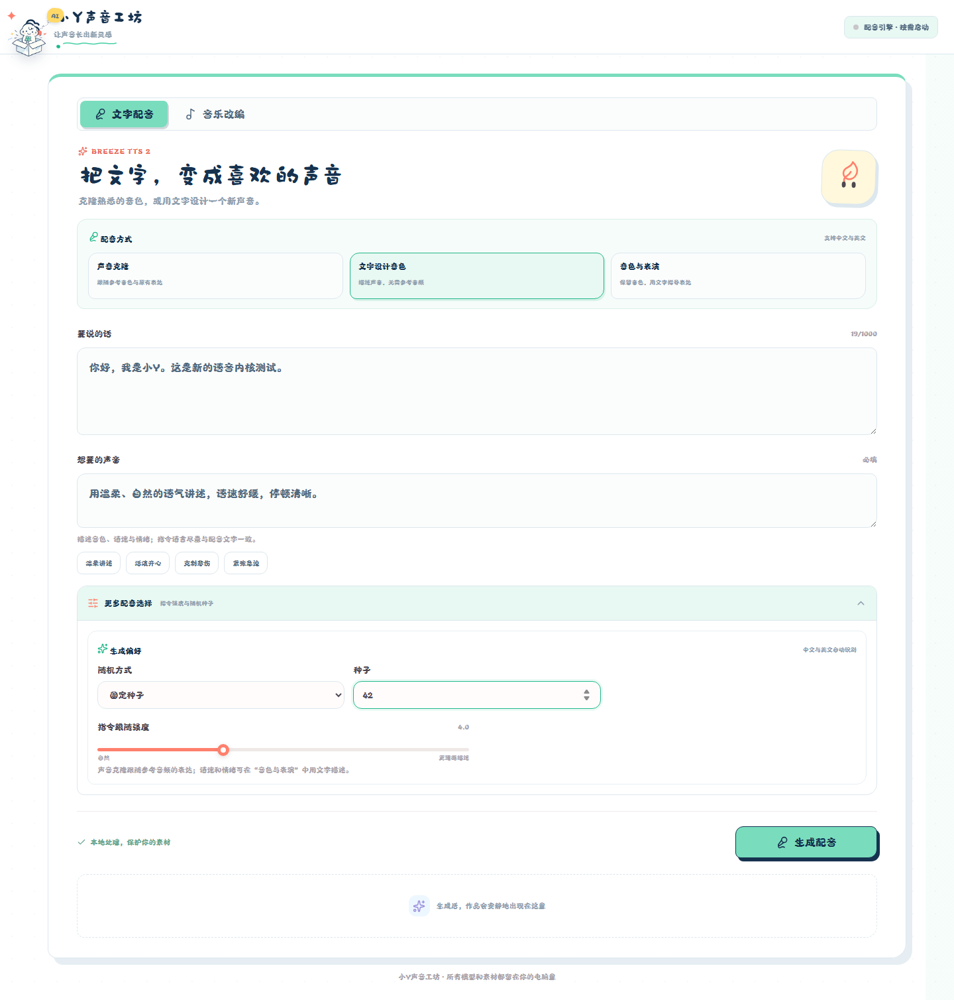
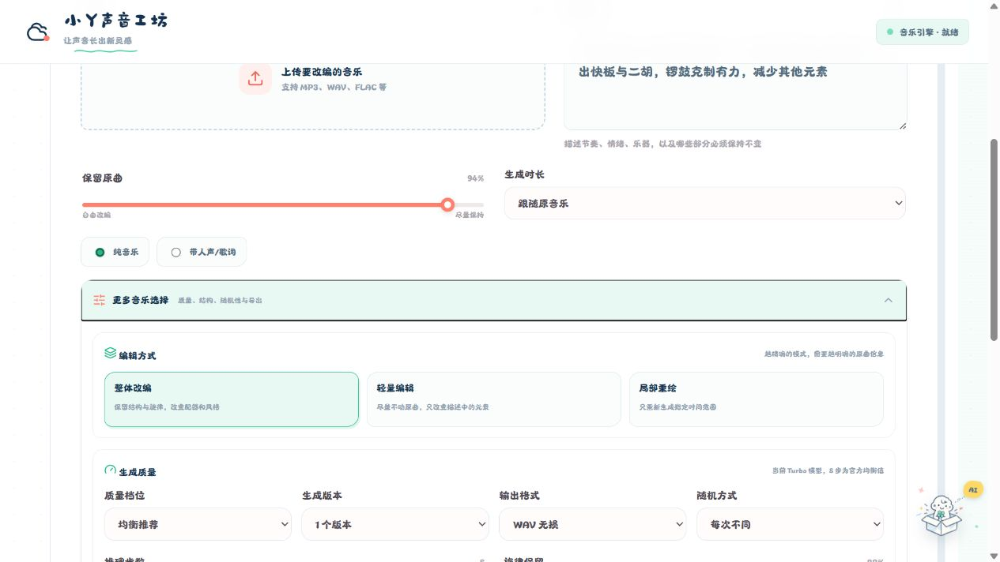
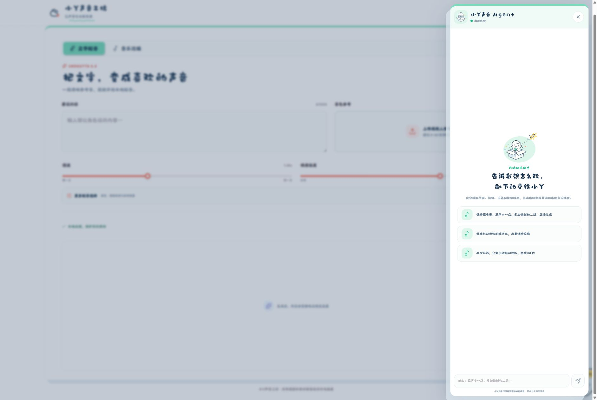
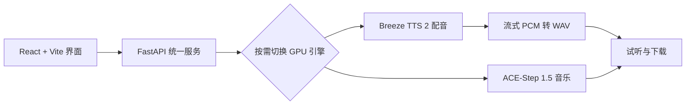

<div align="center">
  
  <h1>Yumi Sound Studio</h1>
  <p><strong>小Y声音工坊 · Make Every Sound Bloom.</strong></p>
  <p>一个可爱、简洁、完全在本地运行的 AI 配音与音乐工作室。</p>
  <p>Breeze TTS 2 × ACE-Step 1.5 · Expressive speech, voice design and reference-based music editing.</p>
</div>

---



## ✨ 它能做什么 / Features

| 功能 | 说明 |
| --- | --- |
| 🎙️ 文字配音 | 基于 **Breeze TTS 2**，支持中文与英文的声音克隆、文字设计音色、音色与表演指导 |
| 😊 表演控制 | 用自然语言描述音色、情绪、语速和停顿，支持 `[笑]`、`[叹气]` 等行内表演标记 |
| 🎵 音乐创作 | 基于 **ACE-Step 1.5** 改编参考音乐，支持纯音乐或带歌词音乐 |
| 🎚️ 参考音乐改编 | 支持整体改编、Flow-Edit 轻量编辑、局部重绘和旋律保留 |
| 🤖 小Y Agent | 用自然语言描述需求，自动整理音乐参数并调用本地模型 |
| 🐾 动态宠物 | 可拖动、记忆位置，并根据待机、专注、思考和完成状态切换姿态 |

> Voice cloning, reference-free voice design, natural-language voice direction and reference-based music editing—all in one local interface.

## 🎙️ Breeze TTS 2 配音

选择一种配音方式，填写要说的话，再点击“生成配音”。支持中文与英文，生成结果可直接试听和下载为 WAV。

| 方式 | 必填内容 | 适合的需求 |
| --- | --- | --- |
| 声音克隆 | 配音文字、参考声音、参考音频文字稿 | 跟随参考音色与原有表达，使用 CFG 1 |
| 文字设计音色 | 配音文字、声音描述 | 无需参考音频，从描述创建音色，默认 CFG 4 |
| 音色与表演 | 配音文字、参考声音、参考文字稿、表演指令 | 保留音色，用文字指导情绪、语速和停顿，默认 CFG 4 |

参考声音支持 **WAV、MP3、FLAC、OGG**，建议使用清晰、无背景音乐、无循环的人声。参考文字稿须逐字对应音频中的全部说话内容，包括重复说的话。

声音描述示例：

> 年轻、清澈的女声，语气温柔自然，语速适中。

表演指令示例：

> 用克制、严肃的语气说话，语速稍慢，句尾适当停顿。

指令语言尽量与配音文字一致。中文可在配音文字中加入 `[笑]`、`[叹气]`，英文可加入 `(laugh)`、`(sigh)`。也可以使用“温柔讲述”“活泼开心”等预设，再展开“更多配音选择”调整指令跟随强度和随机种子。

## 🎵 音乐改编

上传参考音乐后，可以先使用“戏曲急迫”“极简保留”“电影紧张”“国风悲情”等预设，再展开专业设置调整：

- 旋律保留程度、BPM、调式和拍号
- 快速、均衡、高质量推理
- 固定或随机种子
- 一次生成 1–4 个候选版本
- WAV、FLAC、MP3 输出
- 音量标准化、淡入淡出和负面提示词



## 🤖 小Y声音 Agent

点击或拖动右下角的小Y，直接说出想法，例如：

> 保持原节奏，原声小一点，多加快板和二胡，生成两个高质量版本。

小Y会理解节奏、情绪、乐器、保留程度、编辑模式和生成质量，并自动填写参数。音乐和参考素材不会上传到云端。



## 🧩 工作方式



为适配消费级显卡，工作室同一时间只管理一个生成引擎。提交配音或音乐任务时，Yumi 按需启动对应服务，并在切换引擎时停止自己管理的另一服务以释放显存。仅切换页面标签不会加载模型。

## 🚀 本地部署 / Local Setup

### 环境要求

- Windows 10/11
- NVIDIA GPU，Breeze 默认推理推荐至少 12GB 显存（模型本身约占 7.7GiB）；与音乐引擎按需切换
- Python 3.11（Breeze 安装脚本使用独立的 Python 3.11 环境）
- [uv](https://docs.astral.sh/uv/)
- Node.js 22.12+，附带 npm；也支持 Node.js 20.19+
- Git
- 如需音乐功能，先部署 [ACE-Step 1.5](https://github.com/ace-step/ACE-Step-1.5)，并确认其 `start-music.bat` 能在 `127.0.0.1:7861` 启动 Gradio 服务

将工作室与音乐项目放在同一父目录。Breeze 由安装脚本自动部署到相邻目录：

```text
index_tts/
├─ breeze-tts/                 # 上游源码、独立 .venv 与 checkpoints/breeze-tts-2
├─ ACE-Step-1.5/
└─ audio-sprout-studio/
```

### 安装与启动

在目标父目录执行；已有音乐部署时，使用 `ACE-Step-1.5` 所在的父目录：

```powershell
git clone https://github.com/yzz129/Yumi-Sound-Studio.git audio-sprout-studio
cd audio-sprout-studio
uv sync --locked
npm --prefix frontend ci
npm --prefix frontend run build
.\setup-breeze.bat
```

双击 `start-studio.bat`，或执行：

```powershell
uv run python run.py
```

浏览器访问 <http://127.0.0.1:7862/>。

首次安装会联网下载源码、依赖和模型；完成准备后，配音和音乐素材通过本地服务处理。本仓库不包含模型权重。

### 模型安装与 Windows 适配

`setup-breeze.bat` 下载官方源码、CUDA 12.8 / PyTorch 2.9.1 依赖及完整的 Breeze TTS 2 权重（约 7.6GB，包含音频 tokenizer）。Windows 还会生成本地小分片加载缓存，额外约占 7GB；张量数值保持不变，完成后会复用缓存。中断后可重新执行以继续下载。安装脚本固定源码提交 `6eba901d1845353802652c708a4740fdfc5baa75`、模型提交 `3e28c5151381a722f1d8661b4118c298caa77aa4`，便于复现。

Breeze 使用独立 Python 环境，工作室通过 `scripts/breeze_server.py` 调用官方 `breeze_infer.api`，通过 `/health` 判断就绪，通过 `/v1/audio/speech` 接收单声道 24kHz PCM 并封装为 WAV。默认关闭 fast-all，以适配 12–16GB 显卡。上游测试环境为 Linux；Windows 使用 eager 路径，并通过 safetensors 0.8.0 的 `pread` 按张量读取权重、直接加载到 GPU，跳过加载器的一次性大块显存预分配，减少内存映射和 CPU 中转内存的占用，不启用需要额外编译的加速选项。

若源码或模型位于其他目录，在安装和启动工作室之前设置环境变量，例如：

```powershell
$env:BREEZE_TTS_ROOT = "E:\models\breeze-tts"
$env:BREEZE_MODEL_DIR = "E:\models\breeze-tts-2"
.\setup-breeze.bat
.\start-studio.bat
```

默认模型目录是 `breeze-tts/checkpoints/breeze-tts-2`，Windows 小分片缓存位于其 `windows/` 子目录。环境变量应指向原始模型目录；工作室会自动选择准备好的 Windows 缓存。

### 服务端口与本地接口

| 服务 | 地址 | 说明 |
| --- | --- | --- |
| 工作室 | `http://127.0.0.1:7862` | 网页、`/api/status`、`/api/tts`、`/api/music`、`/api/jobs/{job_id}` |
| Breeze TTS 2 | `http://127.0.0.1:7860` | `/health` 健康检查、`/v1/audio/speech` 语音生成 |
| ACE-Step 1.5 | `http://127.0.0.1:7861` | 音乐 Gradio 服务，由 `start-music.bat` 启动 |

`POST /api/tts` 使用表单提交 `mode`、`text`、`instruction`、`cfg_scale`、`seed`；`mode` 可选 `clone`、`design`、`direction`，`seed=-1` 表示随机种子。克隆或表演模式还需提供 `reference` 文件和 `ref_text`。接口返回排队任务，通过 `/api/jobs/{job_id}` 查询进度和最终的 `result_url`。字段约束可在工作室的 `/docs` 查看。

### 从旧版本升级

停止旧版工作室与占用 `7860` 端口的旧语音服务，然后在仓库目录执行：

```powershell
git pull --ff-only
uv sync --locked
npm --prefix frontend ci
npm --prefix frontend run build
.\setup-breeze.bat
.\start-studio.bat
```

本版已移除 IndexTTS 调用以及八维情绪、情绪参考音、搜索束等旧内核专属设置。Breeze 的声音克隆需要额外填写参考音频文字稿；情绪和语速通过“音色与表演”的自然语言指令表达。确认旧目录中的音频已保存后，可移除不再使用的旧内核目录。

### 内存与常见问题

Windows 除显存外也需要足够的系统提交内存。若出现内存不足或音频流中断，请关闭暂时不用的 ComfyUI 等大型程序后重试。工作室不会自动停止其他项目的服务，也不会自动修改系统分页文件设置。

| 现象 | 处理方式 |
| --- | --- |
| 尚未安装 Breeze，或模型文件不完整 | 重新执行 `setup-breeze.bat`，继续下载并准备本地模型 |
| `CUDA out of memory`、`os error 1455` 或音频流中断 | 释放显存与系统提交内存，再生成；详细错误见 `runtime/logs/tts.log` |
| 检测到另一模型由外部窗口启动 | 关闭外部启动的服务后，再由工作室切换引擎 |
| 参考文件为 M4A 或 AAC | 转换为 WAV、MP3、FLAC 或 OGG 后上传 |
| 更新代码后界面仍为旧版 | 重新执行前端构建，重启工作室并刷新浏览器 |

## 📁 项目结构

```text
audio-sprout-studio/
├─ backend/                 # FastAPI、任务管理与模型参数映射
├─ frontend/                # React、可爱风 UI 与小Y Agent
├─ docs/images/             # README 截图
├─ runtime/                 # 本地上传、输出和日志（不会提交）
├─ run.py                   # 统一服务入口
├─ setup-breeze.bat         # Breeze 源码、依赖与模型安装
├─ scripts/                # 固定版本安装、Windows 权重分片与官方 API 启动适配
└─ start-studio.bat         # Windows 一键启动
```

生成结果位于 `runtime/outputs`，运行日志位于 `runtime/logs`。

## ✅ 开发验证

```powershell
npm --prefix frontend run build
uv run pytest -q
```

2026-10-26 在 Windows、RTX 5060 Ti 16GB、Python 3.11 / PyTorch 2.9.1 + CUDA 12.8 环境中完成验证：

| 验证项 | 结果 |
| --- | --- |
| 后端测试 | 53 项通过，覆盖三种模式的参数校验、音频流处理、引擎管理和 Windows 加载适配 |
| 前端生产构建 | TypeScript 检查与 Vite 构建通过 |
| 页面交互 | 1440 × 1100 桌面与 390 × 844 手机视口通过，未发现控制台错误 |
| 真实语音生成 | 文字设计音色、声音克隆、音色与表演均生成可播放、可下载的 WAV |
| Windows 权重缓存 | 1115 个张量的类型、形状及逐张量 SHA-256 与原始权重一致 |

三种模式的短文本测试分别生成了 3.12 秒、2.64 秒和 1.76 秒的音频；这里列出的是音频长度。真实生成验证在 ComfyUI 暂停、系统提交内存已释放的条件下完成。

## 🙏 致谢 / Credits

- [Breeze TTS 2](https://github.com/breezeblue-ai/breeze-tts)
- [ACE-Step](https://github.com/ace-step/ACE-Step-1.5)

请同时遵守本项目依赖和模型各自的许可证及使用条款。Breeze 源码采用 Apache 2.0；其开放权重及自部署输出适用独立的[研究及非商业许可证](https://huggingface.co/BreezeBlue/Breeze-TTS-2/blob/main/LICENSE)。
